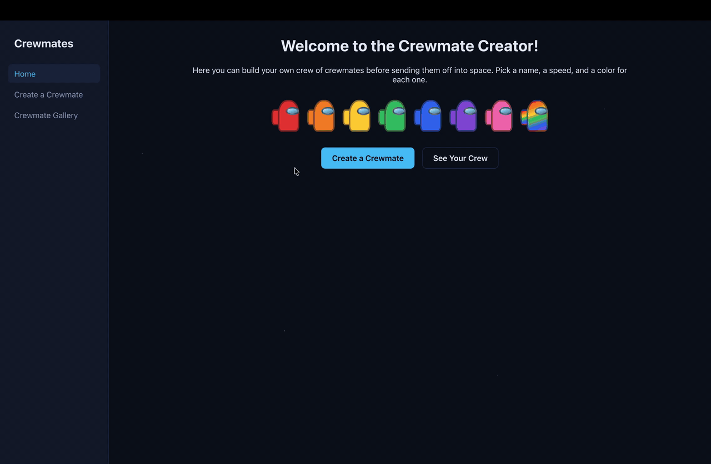

# Web Development Project 7 - *Crewmates*

Submitted by: **Austin Stanley Hinson**

This web app: **A spaceship crew builder where you design your own crewmates and keep them saved in a Supabase database. Users name each crewmate, give them a role (Engineer, Scientist, Pilot, or Captain), and then pick a speed and color by clicking an option, with each role only allowing some speeds and colors. A drawing of the crewmate changes color as you pick. Every crewmate appears in a gallery with the newest at the top, under a crew stats panel and a mission success score that changes the look of the whole list. Each crewmate has its own page with its role, crewmate number, the date it joined the crew, and a line about how fast it is. Crewmates can be edited at any time, with the changes shown right away, or deleted from their edit page.**

Time spent: **X** hours spent in total

## Required Features

The following **required** functionality is completed:

- [x] **The web app contains a page that features a create form to add a new crewmate**
  - Users can name the crewmate
  - Users can set the crewmate's attributes by clicking on one of several values
- [x] **The web app includes a summary page of all the user's added crewmates**
  - The web app contains a summary page dedicated to displaying all the crewmates the user has made so far
  - The summary page is sorted by creation date such that the most recently created crewmates appear at the top
- [x] **A previously created crewmate can be updated from the list of crewmates in the summary page**
  - Each crewmate has an edit button that will take users to an update form for the relevant crewmate
  - Users can see the current attributes of their crewmate on the update form
  - After editing the crewmate's attribute values using the form, the user can immediately see those changes reflected in the update form and on the summary page
- [x] **A previously created crewmate can be deleted from the crewmate list**
  - Using the edit form detailed in the previous _crewmates can be updated_ feature, there is a button that allows users to delete that crewmate
  - After deleting a crewmate, the crewmate should no longer be visible in the summary page
- [x] **Each crewmate has a direct, unique URL link to an info page about them**
  - Clicking on a crewmate in the summary page navigates to a detail page for that crewmate
  - The detail page contains extra information about the crewmate not included in the summary page
  - Users can navigate to the edit form from the detail page

The following **optional** features are implemented:

- [x] A crewmate can be given a category upon creation which restricts their attribute value options
  - e.g., a Dungeons and Dragons class or a development team role (project manager, product owner, etc.)
  - User can choose a `category` option to describe their crewmate before any attributes are specified
  - Based on the category value, users are allowed to access only a subset of the possible attributes
    - Each crewmate is an **Engineer** (1-3 mph; Orange, Yellow, or Red), **Scientist** (2-4 mph; Blue, Green, or Purple), **Pilot** (3-5 mph; Red, Blue, or Pink), or **Captain** (any speed; Purple or Rainbow)
    - Speed and color can't be picked until a role is chosen, and switching roles clears any speed or color the new role doesn't allow
- [x] A section of the summary page, displays summary statistics about a user's crew on their crew page
  - e.g., the percent of members with a certain attribute
    - A Crew Stats panel shows the crew size, average speed, and fastest crewmate, plus bars for the percent of the crew in each role and each color
- [x] The summary page displays a custom "success" metric about a user's crew which changes the look of the crewmate list
  - e.g., a pirate crew's predicted success at commandeering a new galley
    - A **Mission Success** score out of 100: up to 60 points for filling the four roles (15 each), up to 25 for the crew's average speed, and up to 15 for crew size (3 per crewmate, up to 5)
    - 75 or more is "Ready for launch" and the cards glow green, 45 to 74 is "Shaky" and the cards get dashed yellow borders, and under 45 is "Doomed" and the cards turn faded red
    - A tip under the score says how to raise it, e.g. "Add an Engineer to fill an empty role."

The following **additional** features are implemented:

* [x] A drawing of each crewmate in its color, which updates live on the create and edit forms
* [x] A sidebar on every page that highlights the page you're on, and turns into a bar across the top on small screens
* [x] The edit form stays open after saving and shows an "updated!" message, and deleting asks you to confirm first
* [x] The Create button can't be clicked until the name, role, speed, and color are all filled in
* [x] Friendly messages for an empty gallery, a deleted crewmate, and pages that don't exist
* [x] The Supabase project URL and publishable key are kept in a `.env.local` file so they aren't committed to GitHub

## Video Walkthrough

Here's a walkthrough of implemented required features:

<!-- Replace this with whatever GIF tool you used! -->
GIF created with the macOS Screenshot tool (Cmd+Shift+5) and converted to a GIF  
<!-- Recommended tools:
[Kap](https://getkap.co/) for macOS
[ScreenToGif](https://www.screentogif.com/) for Windows
[peek](https://github.com/phw/peek) for Linux. -->

## Notes

One challenge was connecting to Supabase. Most guides talk about an "anon key", but Supabase now calls it the publishable key, and the Connect menu also lists database connection strings that are meant for servers, not a React app. Another challenge was Row Level Security. New Supabase tables block everything until you add policies, so I added policies that let anyone read, add, update, and delete crewmates. Roles were also tricky, because a crewmate could already have a speed or color the new role doesn't allow when the user switches roles, so the form clears just those values. Finally, I had to decide how to score the crew's success. I settled on rewarding a crew that fills every role, moves fast, and has at least five members, and I show how many points each part gives so the score makes sense.

## License

    Copyright 2026 Austin Stanley Hinson

    Licensed under the Apache License, Version 2.0 (the "License");
    you may not use this file except in compliance with the License.
    You may obtain a copy of the License at

        http://www.apache.org/licenses/LICENSE-2.0

    Unless required by applicable law or agreed to in writing, software
    distributed under the License is distributed on an "AS IS" basis,
    WITHOUT WARRANTIES OR CONDITIONS OF ANY KIND, either express or implied.
    See the License for the specific language governing permissions and
    limitations under the License.
